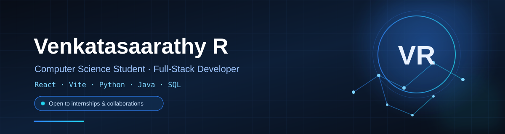
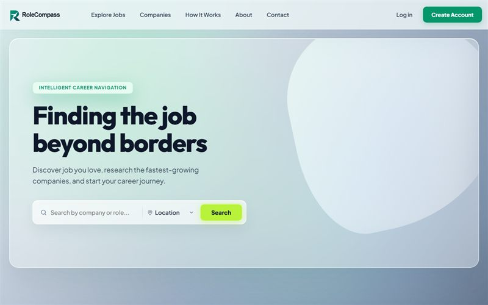
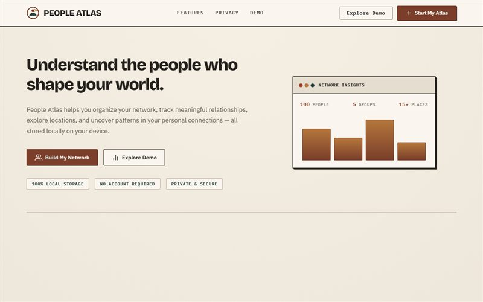
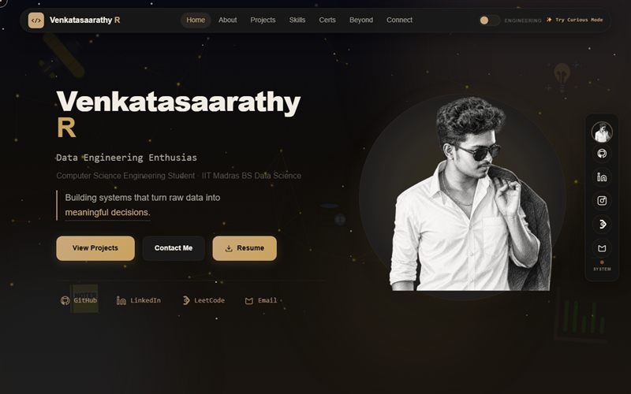
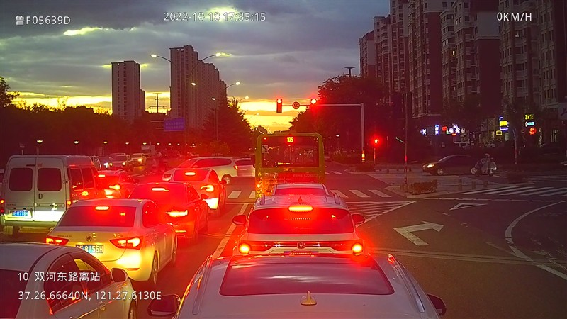



  

    

  
  
  
  

    

  

   

  
  
  

---

## About Me

I'm a **Computer Science and Engineering** undergraduate at **Prince Dr. K. Vasudevan College of Engineering and Technology, Chennai**, and a **BS in Data Science and Applications** student at **IIT Madras**.

I like taking a problem from idea to deployed product — designing the interface, structuring the state, and shipping something people can actually use. My work centers on **React front-end applications** with role-based access, persistent client-side state, and fully responsive layouts, backed by **Java**, **Python**, and **SQL** fundamentals.

<table>
  <tr>
    <td width="50%" valign="top">
      <strong>What I'm doing now</strong>
      <ul>
        <li>Building production-style React applications</li>
        <li>Strengthening data engineering and SQL skills</li>
        <li>Solving DSA problems on LeetCode</li>
      </ul>
    </td>
    <td width="50%" valign="top">
      <strong>What I enjoy</strong>
      <ul>
        <li>Clean UI, thoughtful UX, and accessible design</li>
        <li>Turning datasets into useful, explainable models</li>
        <li>Chess, cricket, travel, and continuous learning</li>
      </ul>
    </td>
  </tr>
</table>

---

## Highlights

| Milestone | Detail |
| --- | --- |
| **B.E. CSE** | Prince Dr. K. Vasudevan College of Engineering and Technology · CGPA **8.7** · Expected 2029 |
| **IIT Madras** | BS in Data Science and Applications · Foundation Level in progress |
| **Deployed apps** | 3 production-style React applications live on Netlify |
| **NPTEL** | Object-Oriented Programming — **Elite Grade (79%)** |
| **Hackathon** | Smart India Hackathon prototype — **BUS-SENSE AI**, a smart city and transport command center |
| **Certifications** | HackerRank Java · FreeCodeCamp Responsive Web Design · Microsoft Canvas App · Microsoft Secure Storage |
| **Typewriting** | Senior Grade with Distinction |

---

## Featured Work

<table>
  <tr>
    <td width="52%">
      
    </td>
    <td width="48%" valign="top">
      <h3>RoleCompass</h3>
      
Career-intelligence platform where candidates discover roles, score their skill fit, follow learning roadmaps, and track applications — while employers publish roles and manage a hiring pipeline.

      
<code>React 19</code> <code>Vite</code> <code>React Router 7</code> <code>Context API</code>

      

        <a href="https://rolecompass1.netlify.app/"><strong>Live demo</strong></a> ·
        <a href="https://github.com/Venkat-1506/rolecompass">Source</a>
      

    </td>
  </tr>
</table>

<table>
  <tr>
    <td width="52%">
      
    </td>
    <td width="48%" valign="top">
      <h3>ContactDesk (People Atlas)</h3>
      
A personal relationship CRM for your close circle, family, classmates, and professional network — with live SVG insight charts, isolated workspaces, and JSON import/export.

      
<code>React 19</code> <code>React Router</code> <code>Vite</code> <code>Vitest</code>

      

        <a href="https://contactdesk.netlify.app/"><strong>Live demo</strong></a> ·
        <a href="https://github.com/Venkat-1506/ContactDesk">Source</a>
      

    </td>
  </tr>
</table>

<table>
  <tr>
    <td width="52%">
      
    </td>
    <td width="48%" valign="top">
      <h3>Personal Portfolio</h3>
      
A dual-mode (<code>engineering</code> / <code>creative</code>) portfolio with an animated canvas background, custom cursor, reveal-on-scroll animations, and client-side routing.

      
<code>React 19</code> <code>Vite</code> <code>React Router</code> <code>CSS</code>

      

        <a href="https://venkatasaarathy.netlify.app/"><strong>Live demo</strong></a> ·
        <a href="https://github.com/Venkat-1506/myportfolio-react">Source</a>
      

    </td>
  </tr>
</table>

<table>
  <tr>
    <td width="52%">
      
    </td>
    <td width="48%" valign="top">
      <h3>BUS-SENSE AI</h3>
      
Smart India Hackathon prototype that turns bus camera and GPS observations into actionable city alerts — potholes, waterlogging, obstructions, and more — for transport and urban intelligence.

      
<code>React</code> <code>FastAPI</code> <code>YOLO</code> <code>Python</code>

      

        <a href="https://github.com/Venkat-1506/risk-radar"><strong>Source</strong></a>
      

    </td>
  </tr>
</table>

### More Projects

| Project | Description | Stack |
| --- | --- | --- |
| [FIND-ER](https://find-er-campus.netlify.app/welcome.html) | Campus lost & found platform with student/admin dashboards, messaging, notifications, and recovery tracking | HTML · CSS · JavaScript |
| [Elite College Portal](https://elite-college-portal.netlify.app/) | Multi-page college portal with admissions, placements, events, gallery, and dark/light themes | HTML · CSS · JavaScript |
| [FireGuard](https://github.com/Venkat-1506/FIREGUARD) | Fire safety equipment register and inspection management app with a Flask API | React · Flask · Python |
| [Spendly](https://github.com/Venkat-1506/Spendly) | SaaS-style expense tracker for Indian users with budgets, analytics, and AI-powered insights | HTML · CSS · JavaScript |
| [Take It Quiz](https://github.com/Venkat-1506/take-it-quiz) | Secure quiz platform with proctored exams, anti-cheating monitoring, and analytics | React · JavaScript |
| [Diabetes Prediction](https://github.com/Venkat-1506/CodeAlpha_DiseasePrediction) | Logistic regression classifier for early diabetes indicators | Python · Pandas · Scikit-learn |
| [Handwritten Digit Recognition](https://github.com/Venkat-1506/CodeAlpha_HandwrittenRecognition) | CNN trained on MNIST with ~97% accuracy | Python · TensorFlow |
| [OOPS Java Projects](https://github.com/Venkat-1506/OOPS-Java-Projects) | Console apps demonstrating OOP, collections, exceptions, and design patterns | Java · OOP |

---

## Tech Stack

  

 

**Currently learning:** Data Engineering · Cloud Computing · PostgreSQL

---

## GitHub Stats

  

  

---

## Education

| Degree | Institution | Status |
| --- | --- | --- |
| B.E. Computer Science and Engineering | Prince Dr. K. Vasudevan College of Engineering and Technology, Chennai | Expected 2029 · CGPA 8.7 |
| BS in Data Science and Applications | Indian Institute of Technology (IIT) Madras | In progress · Foundation Level |

---

## Connect

<a href="https://venkatasaarathy.netlify.app/">Portfolio</a> ·
<a href="https://www.linkedin.com/in/venkatasaarathy/">LinkedIn</a> ·
<a href="https://leetcode.com/u/Venkatasaarathy/">LeetCode</a> ·
<a href="https://github.com/Venkat-1506">GitHub</a> ·
<a href="mailto:venkatasaarathy@gmail.com">Email</a>

  

<em>I believe the best engineers never stop learning.</em>

